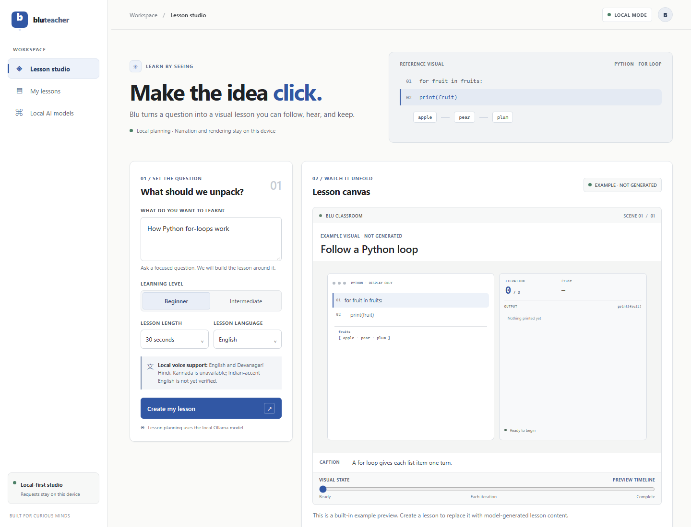
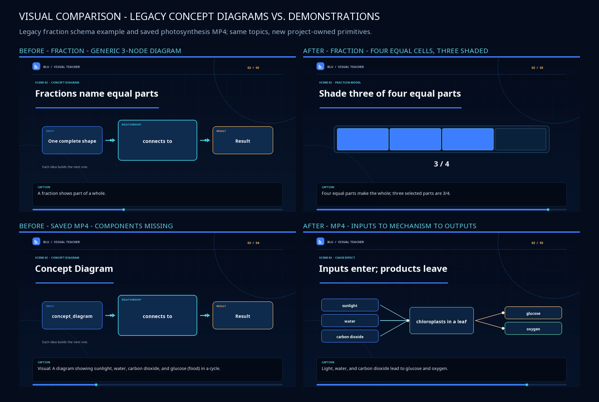

# Blu Visual Teacher

**Turn a question into a narrated visual lesson you can inspect, play, and export.**

[](https://www.python.org/)
[](https://react.dev/)
[](https://fastapi.tiangolo.com/)

Blu is a local-first visual lesson studio. It plans a short lesson, presents its ideas through purpose-built visual scenes, adds local narration and synchronized captions, and exports a validated MP4.

## The product in 30 seconds

1. Choose a topic, learning level, language, and target length (30, 45, 60, or 90 seconds).
2. A local Ollama model returns a structured, 3–6 scene lesson. Pydantic validates the lesson and its bounded visual data.
3. Local translation and speech models prepare the lesson; the browser preview and exported video follow the measured narration timeline.
4. Play the lesson, inspect scene timing, and download the MP4 and SRT captions.

## Why it exists

Many lessons describe a mechanism in words when learners would benefit from seeing the parts and state changes. Blu explores a compact alternative: introduce a concept, demonstrate a supported mechanism, then reinforce it with narration and captions.

The lesson plan is generated and must be reviewed for accuracy. Schema validation checks structure and bounds; it does not fact-check the explanation.

## Features

- 🎓 **Concept-aware scenes:** title cards, concept diagrams, process flows, code walkthroughs, Python-loop execution, fraction area models, and cause/effect demonstrations.
- 🧩 **Bounded visual data:** model output is validated against project-owned schemas. The renderer never executes model-generated code or drawing instructions.
- 🌐 **Three lesson languages:** English, Hindi, and Kannada. Planning is in English; Hindi and Kannada lesson text is translated locally.
- 🗣️ **Local narration:** Kokoro-ONNX handles English and Hindi; Indic Parler-TTS handles Kannada.
- 🎞️ **Timed exports:** scene durations come from synthesized audio, with pauses and SRT captions aligned to the narration. FFmpeg produces the MP4 and FFprobe checks it.
- 🔁 **Synchronized preview:** scene progress, captions, and the exported timing manifest drive the browser lesson player.
- 📴 **Local runtime:** after installation and model downloads, planning, translation, narration, rendering, and playback use local services and files.

## Screenshots and sample lessons



[View the mobile layout](output/ui-mobile-final.png)

The visual comparison below uses rendered scenes from the programming, fractions, and photosynthesis examples.



Sample exports:

- [Python loop — MP4](output/visual-comparison/programming-loop.mp4)
- [Fractions — MP4](output/visual-comparison/fractions.mp4)
- [Photosynthesis — MP4](output/visual-comparison/photosynthesis-progressive.mp4)

## Architecture

The planner emits lesson data, not executable visuals. Validated scene data is passed to built-in renderers; measured speech durations determine the timeline used by the video and browser preview.

```mermaid
flowchart LR
    UI["React + TypeScript<br/>Vite lesson studio"]
    API["FastAPI<br/>local API"]
    LLM["Ollama<br/>qwen2.5:3b"]
    SCHEMA["Pydantic lesson schema<br/>3–6 bounded scenes"]
    TRANS["IndicTrans2<br/>English → Hindi / Kannada"]
    JOB["In-memory render job"]
    KOKORO["Kokoro-ONNX<br/>English / Hindi"]
    PARLER["Indic Parler-TTS<br/>Kannada"]
    TIME["Measured WAV timeline<br/>scene timings + SRT"]
    PIL["Pillow scene renderer<br/>1280 × 720 · 24 fps"]
    FFMPEG["FFmpeg<br/>H.264 + AAC"]
    PROBE["FFprobe validation"]
    MEDIA["MP4 · SRT · JSON manifest<br/>output/videos/lessons"]
    CANVAS["React VisualLessonCanvas<br/>manifest-timed playback"]

    UI -->|"POST /api/lessons"| API
    API --> LLM --> SCHEMA
    SCHEMA -->|"English"| JOB
    SCHEMA -->|"Hindi / Kannada"| TRANS --> JOB
    JOB -->|"English / Hindi"| KOKORO
    JOB -->|"Kannada"| PARLER
    KOKORO --> TIME
    PARLER --> TIME
    TIME --> PIL
    TIME --> FFMPEG
    PIL --> FFMPEG --> PROBE --> MEDIA
    MEDIA --> API
    API -->|"job status, video, captions, manifest"| UI
    API -.->|"same scene timing"| CANVAS
```



## Technology and model licences

| Component | Role | Upstream licence / notes |
|---|---|---|
| React 19, TypeScript, Vite | Browser UI and development server | Package licences are in the npm dependency metadata. |
| FastAPI, Pydantic, Pillow | API, schema validation, and scene frames | Pinned Python dependencies are listed in `backend/requirements.txt`. |
| Ollama `qwen2.5:3b` | Local lesson planner | The Ollama tag lists the **Qwen Research License**. Review the [model page](https://ollama.com/library/qwen2.5:3b) and its terms for your intended use. |
| Kokoro-82M + `kokoro-onnx` | English and Hindi speech | Model weights: Apache-2.0; ONNX adapter: MIT. The `voices-v1.0.bin` voice pack is a separate asset; retain and check its upstream notices before redistribution. [Model](https://huggingface.co/hexgrad/Kokoro-82M) · [Adapter](https://github.com/thewh1teagle/kokoro-onnx) |
| `ai4bharat/indictrans2-en-indic-dist-200M` | English-to-Indic lesson translation | MIT; access to the model files requires accepting the Hugging Face repository conditions. [Model card](https://huggingface.co/ai4bharat/indictrans2-en-indic-dist-200M) |
| `ai4bharat/indic-parler-tts` | Kannada narration | Apache-2.0. The downloader can fall back to `ai4bharat/indic-parler-tts-pretrained`. [Model card](https://huggingface.co/ai4bharat/indic-parler-tts) |
| `google/flan-t5-large` tokenizer files | Encodes the Parler voice description; model weights are not downloaded for this use | Apache-2.0. [Model card](https://huggingface.co/google/flan-t5-large) |
| Bundled Noto fonts | Latin, Devanagari, and Kannada scene text | SIL Open Font License 1.1; notices are in `backend/assets/fonts/`. |
| FFmpeg / FFprobe | H.264/AAC encoding and output verification | Installed separately; this repository does not bundle FFmpeg. Encoder licensing depends on the local FFmpeg build. |

Model weights and caches live under `models/`, which is Git-ignored. Download them locally; they are not included in a source checkout.

**Project licence:** this repository has no top-level `LICENSE` file. The third-party licences above apply to those components and do not specify a licence for Blu’s application code.

## Prerequisites

- Python 3.12, Node.js with npm, and Git.
- [Ollama](https://ollama.com/download) with the `qwen2.5:3b` model.
- FFmpeg and FFprobe available on `PATH`. The FFmpeg build must include `libx264` and AAC support.
- Several gigabytes of disk space for local model weights. CPU execution is supported; no GPU is required. No minimum RAM specification has been established.

The commands below use Windows PowerShell from the repository root. The project does not pin a Node.js version.

## Install

Create the Python environment and install the pinned backend dependencies:

```powershell
python -m venv .venv
.\.venv\Scripts\python.exe -m pip install -r backend\requirements.txt
npm.cmd install
ollama pull qwen2.5:3b
```

Download the Kokoro-ONNX model and voice pack. These files are not fetched automatically by the application:

```powershell
New-Item -ItemType Directory -Force models\kokoro-onnx | Out-Null
Invoke-WebRequest 'https://github.com/thewh1teagle/kokoro-onnx/releases/download/model-files-v1.1/kokoro-v1.0.int8.onnx' -OutFile models\kokoro-onnx\kokoro-v1.0.int8.onnx
Invoke-WebRequest 'https://github.com/thewh1teagle/kokoro-onnx/releases/download/model-files-v1.1/voices-v1.0.bin' -OutFile models\kokoro-onnx\voices-v1.0.bin
```

Hindi/Kannada translation and Kannada narration use gated Hugging Face model repositories. Accept the repository conditions and create a read token with access before downloading:

```powershell
$env:HF_TOKEN = 'hf_your_read_token'
.\.venv\Scripts\python.exe -m backend.download_local_models
Remove-Item Env:HF_TOKEN
```

The downloader installs IndicTrans2, Indic Parler-TTS (or its configured pretrained fallback), and the FLAN-T5 tokenizer files under `models/`. The token is for setup only; the runtime loads local files.

If FFmpeg is not discoverable on `PATH`, configure its executable paths in the backend terminal before startup:

```powershell
$env:FFMPEG_BIN = (Get-Command ffmpeg.exe).Source
$env:FFPROBE_BIN = (Get-Command ffprobe.exe).Source
```

## Configure

All listed variables are optional. Defaults are shown.

| Variable | Default | Purpose |
|---|---|---|
| `BLU_OLLAMA_URL` | `http://localhost:11434` | Ollama base URL. Only loopback hosts are accepted. |
| `BLU_OLLAMA_MODEL` | `qwen2.5:3b` | Installed local planner model tag; Blu does not pull it automatically. |
| `BLU_OLLAMA_TIMEOUT_SECONDS` | `120` | Planner request timeout. |
| `BLU_KOKORO_MODEL` | `models/kokoro-onnx/kokoro-v1.0.int8.onnx` | Kokoro ONNX model path. |
| `BLU_KOKORO_VOICES` | `models/kokoro-onnx/voices-v1.0.bin` | Kokoro voice pack path. |
| `BLU_INDICTRANS_DIR` | `models/indictrans2-en-indic-dist-200M` | IndicTrans2 model directory. |
| `BLU_PARLER_DIR` | `models/indic-parler-tts` | Indic Parler-TTS model directory. |
| `FFMPEG_BIN`, `FFPROBE_BIN` | Search `PATH` | Override paths to the local encoder and probe executables. |

## Run locally

Start each process in its own PowerShell window:

```powershell
# Window 1 — API
.\.venv\Scripts\python.exe -m uvicorn backend.main:app --reload

# Window 2 — web app
npm.cmd run dev
```

Open the Vite URL shown in the second window (normally `http://localhost:5173`). The Vite development server proxies `/api` requests to `http://127.0.0.1:8000`.

- API health: `http://127.0.0.1:8000/api/health`
- Interactive API docs: `http://127.0.0.1:8000/docs`

## Use Blu

Example topic: **“How does a Python for-loop print each fruit?”**

1. Enter the topic and choose a level, language, and target length.
2. Select **Create my lesson**. Review the scene titles, narration, visual data, and planner/fallback status.
3. Use the scene selector and visual progress slider to inspect the demonstration.
4. Select **Render narrated MP4**. When the job completes, play the video or download the MP4 and SRT captions.

The API routes used by the UI are:

| Route | Purpose |
|---|---|
| `GET /api/health` | Reports local planner configuration and fallback availability. |
| `POST /api/lessons` | Creates a validated lesson plan. |
| `POST /api/lessons/{lesson_id}/render` | Queues narration and video export. |
| `GET /api/renders/{job_id}` | Returns render-job status and timing metadata. |
| `GET /api/media/{job_id}/video` | Plays the rendered MP4. |
| `GET /api/media/{job_id}/download` | Downloads the MP4. |
| `GET /api/media/{job_id}/captions` | Downloads SRT captions. |
| `GET /api/media/{job_id}/manifest` | Returns scene timing and visual timeline data. |

Render jobs and lesson registrations are held in memory; restarting the API loses their status. Completed files are written to `output/videos/lessons/`.

## Languages, offline use, and limits

- **English:** planned and narrated with local Ollama and Kokoro-ONNX.
- **Hindi:** planned in English, translated with local IndicTrans2, then narrated with Kokoro-ONNX.
- **Kannada:** planned in English, translated with local IndicTrans2, then narrated with Indic Parler-TTS.
- Translation and narration weights must be downloaded first. The application runtime uses the local Ollama service, local model files, and local FFmpeg tools; the complete Wi-Fi-disabled setup and export path remains an outstanding acceptance check.
- Model output can be incomplete or incorrect. Pydantic validates lesson shape and bounds, not educational or factual accuracy; inspect a lesson before exporting.
- Planner and translation failures use a deterministic sample fallback. Fallback status and reason are returned to the UI.
- Kannada Parler-TTS uses a 0.9B-parameter full-precision model and may render slowly on CPU. The repository has no validated minimum RAM specification.
- Hindi/Kannada pronunciation and intelligibility have not had a human listening review. Indian-accented English is not verified.
- Render-job records are ephemeral, even though completed MP4/SRT/JSON files remain on disk.

## Tests

Install the backend dependencies and npm packages first.

```powershell
.\.venv\Scripts\python.exe -m pytest backend\tests -q
npm.cmd test
npm.cmd run lint
npm.cmd run build
```

Most tests use deterministic fake narrators and stubbed services. The opt-in local media integration test uses real local models and FFmpeg, can take several minutes on CPU, and writes a render output:

```powershell
$env:BLU_RUN_LOCAL_MEDIA_INTEGRATION = '1'
.\.venv\Scripts\python.exe -m pytest backend\tests\test_gate3_local_integration.py -q -s
Remove-Item Env:BLU_RUN_LOCAL_MEDIA_INTEGRATION
```

## Project structure

```text
src/
  App.tsx                  React studio, lesson requests, playback and export controls
  VisualLessonCanvas.tsx   Built-in browser scene components
  visualTimeline.ts        Manifest/timeline helpers
backend/
  main.py                  FastAPI routes
  schemas.py               Pydantic lesson and visual-data contracts
  services/
    ollama_planner.py      Local structured lesson planning
    translation_service.py English-to-Indic translation
    narration_service.py  Kokoro-ONNX narration
    indic_narrator.py     Kannada Parler-TTS narration
    scene_renderer.py     Pillow scene rendering
    export_service.py     Audio timeline, SRT, FFmpeg and FFprobe
    render_jobs.py        In-memory job orchestration and media serving
  assets/fonts/            Bundled Noto fonts and OFL notices
docs/
  requirements-reconciliation.md
output/visual-comparison/  Existing rendered examples and visual comparisons
```

## Contributing

- Keep visual actions declarative and bounded; add project-owned renderer components rather than evaluating model-provided code.
- Update both the Pydantic contract and frontend validation when changing lesson or visual data.
- Preserve measured narration timing, caption alignment, local model loading, and CPU support.
- Add or update focused tests and document the source and licence for new model or media assets.
- Run the backend and frontend checks above before opening a pull request.

## Roadmap: documented verification work

The repository has no dated feature roadmap. Its current open validation items are:

- Conduct human listening reviews of Hindi and Kannada speech for intelligibility and pronunciation.
- Run the complete setup, generation, and export flow with network access disabled after model installation.
- Verify rendered-video playback and scene controls on a physical mobile device.

These are validation tasks, not claims of scheduled releases.
